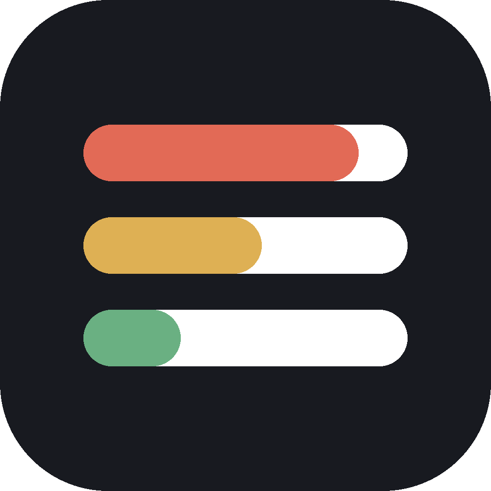

# LimitBar

A small always-on-top window showing how much of each AI agent's rate limit you
have used. It finds the agents installed on your machine, reads the credentials
they already store, asks each vendor's own usage endpoint, and draws one progress
bar per limit window — every agent in one window, split into sections.



## Read this before you use it

**LimitBar reads your agents' access tokens.** That is unavoidable: asking an
endpoint how much of *your* limit you have used means proving who you are, and the
proof is the same OAuth token `claude` and `codex` already keep on your disk.

**Each token goes to exactly one place: the vendor it belongs to, and nowhere
else.** It travels as an `Authorization` header on a GET request with no body.
There is no server of mine anywhere in the picture — no telemetry, no analytics,
no update check, no crash reporting. Tokens are never logged, never shown on
screen, and never written back to disk. You do not have to take my word for any of
this; the [audit table below](#there-are-no-binary-downloads-on-purpose) points at
the exact files, and they are short.

**But please understand what you are taking on.** Usage endpoint is not a
documented public API.
Using them from a third-party tool may be against Anthropic's or OpenAI's terms of
service, now or after a future change to them, and they are free to rate-limit,
suspend or ban accounts over it. LimitBar polls no faster than once every 15
seconds, stops entirely while its window is hidden, backs off when asked to, and
offers a manual mode that sends nothing at all until you press the button — but
restraint is not permission, and none of it is a guarantee.

**This software comes with no warranty of any kind** (see [LICENSE](LICENSE)). The
author accepts no responsibility for bugs, for anything that follows from them, or
for any action a vendor takes against your account. If that trade is not one you
want to make, do not run it. If it is, you are making it knowingly, and that is the
whole reason this section exists.

## There are no binary downloads, on purpose

**This project will never publish releases, installers or prebuilt executables.
Build it yourself.**

LimitBar reads the OAuth tokens that `claude` and `codex` keep on your disk. Those
tokens are the keys to your Claude and ChatGPT accounts. A prebuilt binary is an
opaque blob: nothing about a downloaded `.exe` proves it was built from the source
in this repository, and a tool whose entire job is touching your credentials is
exactly the wrong thing to take on faith. Signed releases and reproducible builds
would narrow that gap, but they would not close it, and pretending otherwise would
be worse than simply not offering the download.

So the trust model here is the plain one: read the source, then compile it. It is
a few hundred lines, and the parts that matter are short enough to audit in one
sitting:

| What to check | Where |
|---|---|
| Every URL the app can contact | `DEFAULT_BASE_URL` in `core/src/providers/claude.rs` and `codex.rs` |
| Every credential file it opens | `core/src/providers/creds.rs` |
| That it only ever reads them | `grep -rn "fs::write\|File::create" core/src/providers/` — the only hits are inside `#[cfg(test)]` blocks writing fixtures to temp dirs |
| What leaves your machine | the two `fetch` methods — a GET with an `Authorization` header and no body |

There is no telemetry, no analytics, no update check, no crash reporting, and no
third-party network destination. `grep -rn "https://" core/src` returns one host
per supported agent, each one that agent's own vendor, and nothing else.

## Supported agents

| Agent | Credentials read |
|---|---|
| Claude Code | `$CLAUDE_CONFIG_DIR/.credentials.json`, else `<home>/.claude/.credentials.json` |
| Codex | `$CODEX_HOME/auth.json`, else `<home>/.codex/auth.json` |

Each request is formed the way that agent's own CLI forms it, because the endpoint
and its headers are what authorise and route the call. The one deliberate
difference is the `User-Agent`, which says `limitbar/<version>`: the bearer token
is the gate here, and passing ourselves off as an official CLI would be a disguise,
not compatibility. If you want to know precisely what is sent, it is in
`core/src/providers/` — two short `fetch` methods — and the `wiremock` tests assert
every header of both.

Neither endpoint is a documented public API. Either can change without notice, so
the parsing is defensive — unknown fields are ignored, missing windows are simply
not drawn, and a body we cannot read becomes a visible "unexpected response"
rather than a crash.

## Why it never writes the credential files

Reading them is enough, and writing them would be actively harmful. OpenAI rotates
refresh tokens, so saving a refreshed one would invalidate the copy a running
`codex` holds; a concurrent write would race the live CLI for the same file. So
LimitBar never refreshes a token and never writes one back. When a stored token has
expired, the section says so and tells you to sign in with the agent itself.

## Refreshing

The period picker offers **Manual** and 15/30/45/60/120 seconds, and the
choice is remembered across restarts. On manual, no timer runs at all and no
request is ever sent until you press ⟳ — not on startup, and not when the window
comes back into view. Because the numbers then age on screen, a footer shows how
long ago they were fetched, or that nothing has been fetched yet.

On a timer, polling stops entirely while the window is hidden and resumes with one
immediate fetch. A `429` is honoured via `Retry-After`; other failures back off
60 s → 2 min → 5 min → 15 min. Throughout, the last good numbers stay on screen,
dimmed, next to a sentence saying what went wrong.

## Building

### Windows

From a normal PowerShell — **not** from inside WSL. A binary built in WSL is a
Linux binary and will look for credentials in the WSL filesystem, not in your
Windows profile.

```powershell
winget install Microsoft.VisualStudio.2022.BuildTools   # workload: Desktop development with C++
winget install Rustlang.Rustup
winget install OpenJS.NodeJS

git clone https://github.com/<you>/limitbar
cd limitbar
npm install
npm run tauri build
```

WebView2 is already present on Windows 10 1803+ and Windows 11.

**Where the build lands.** This is a cargo workspace, so there is one `target\`
directory at the repository root — *not* one inside `src-tauri\`:

```
target\release\LimitBar.exe                                  ← portable, runs on its own
target\release\bundle\msi\LimitBar_0.1.0_x64_en-US.msi       ← installer
target\release\bundle\nsis\LimitBar_0.1.0_x64-setup.exe      ← installer
```

`LimitBar.exe` is self-contained: the web assets are compiled into it, so you can
copy that one file anywhere and run it. Settings go to `%APPDATA%\limitbar\`, not
next to the executable. If you only want the executable and no installers:

```powershell
npm run tauri build -- --no-bundle
```

These Windows paths follow the same layout as the Linux build below, which is the
one I verified by running it; I have no Windows machine to confirm the exact
installer filenames on.

Two caveats for the frameless window on Windows: it has no system drop shadow, and
Aero Snap works only by dragging to a screen edge, since the double-click and
`Win`+arrow gestures belong to the title bar we removed. Resizing from the edges
works as usual.

### Linux

```sh
sudo apt install -y libwebkit2gtk-4.1-dev libsoup-3.0-dev libjavascriptcoregtk-4.1-dev \
  build-essential curl wget file libxdo-dev libssl-dev libayatana-appindicator3-dev \
  librsvg2-dev pkg-config

npm install
npm run tauri dev      # development
npm run tauri build    # release build + packages
```

**Where the build lands.** One `target/` at the repository root, because this is a
cargo workspace — *not* inside `src-tauri/`:

```
target/release/LimitBar                                      ← portable, runs on its own
target/release/bundle/deb/LimitBar_0.1.0_amd64.deb
target/release/bundle/rpm/LimitBar-0.1.0-1.x86_64.rpm
target/release/bundle/appimage/LimitBar_0.1.0_amd64.AppImage ← portable, self-contained
```

`target/release/LimitBar` is a single 15 MB executable with the web assets compiled
in; it needs the system WebKitGTK libraries listed above. The AppImage carries its
own copy of them, so that is the one to hand to someone else. For the executable
alone, with no packaging step:

```sh
npm run tauri build -- --no-bundle
```

Under WSLg, if the window comes up blank, run it with
`WEBKIT_DISABLE_DMABUF_RENDERER=1`.

### macOS

`xcode-select --install`, then the same `npm install` / `npm run tauri build`.
Note that Claude Code may keep its token in the Keychain rather than in
`.credentials.json`, in which case the section will say sign-in is needed —
reading the Keychain is not implemented.

### Where settings live

| Platform | Path |
|---|---|
| Windows | `%APPDATA%\limitbar\settings.json` |
| Linux | `$XDG_CONFIG_HOME/limitbar/settings.json`, else `~/.config/limitbar/` |
| macOS | `~/.config/limitbar/settings.json` |

On Windows the home directory is `%USERPROFILE%`, and it deliberately outranks
`HOME`: Git Bash and MSYS export a `HOME` of their own, which is not where `claude`
and `codex` write.

## Checking the numbers yourself

```sh
cargo run -p limitbar-core --example probe
```

prints exactly what the widget would draw, without opening a window — useful for
comparing against `/usage` in `claude` and `/status` in `codex`, and for diagnosing
a section that shows an error. It prints percentages and reset times only.

## How it is put together

```
core/        limitbar-core — domain model, providers, polling policy. No Tauri.
src-tauri/   the desktop shell: a window and six commands.
src/         the widget: title bar, interval picker, sections, gauges.
```

`core` deliberately has no Tauri dependency, so all of the logic is testable with a
plain `cargo test` and auditable without reading any GUI code. Agent-specific
knowledge — where credentials live, how to form the request, how to read the reply
— sits behind one `LimitProvider` trait. The widgets only ever see a neutral
`Snapshot` / `AgentSnapshot` / `Gauge` model and never mention a vendor.

Adding a third agent is one new file under `core/src/providers/` and one line in
`default_providers()`. No widget code changes.

## Tests

```sh
cargo test --workspace
```

61 tests: response parsing against fixtures shaped after real replies, credential
discovery across platforms, the backoff ladder, the stale-data policy, and
`wiremock` tests that assert every outgoing header and map each HTTP status onto
the message the user ends up seeing. Visual behaviour is not covered by tests.

## Interface language

The UI is in Russian. Every string lives in `src/ui/strings.ts`, so translating it
is a one-file change. Gauge labels (`Session (5h)`, `Weekly`) come from the
providers and match the wording each agent's own output uses, which keeps
side-by-side comparison with `/usage` and `/status` literal.

## License

MIT. See [LICENSE](LICENSE).
